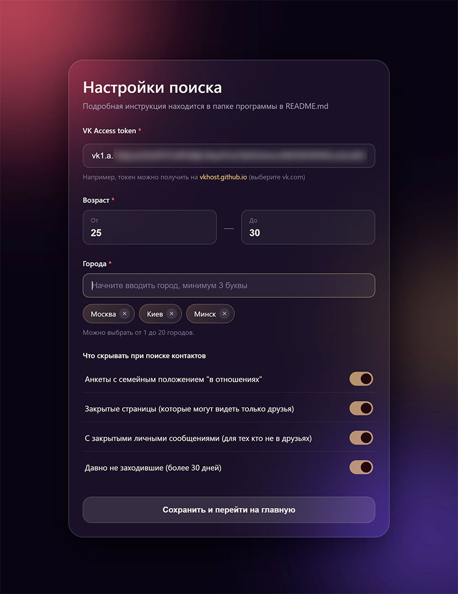
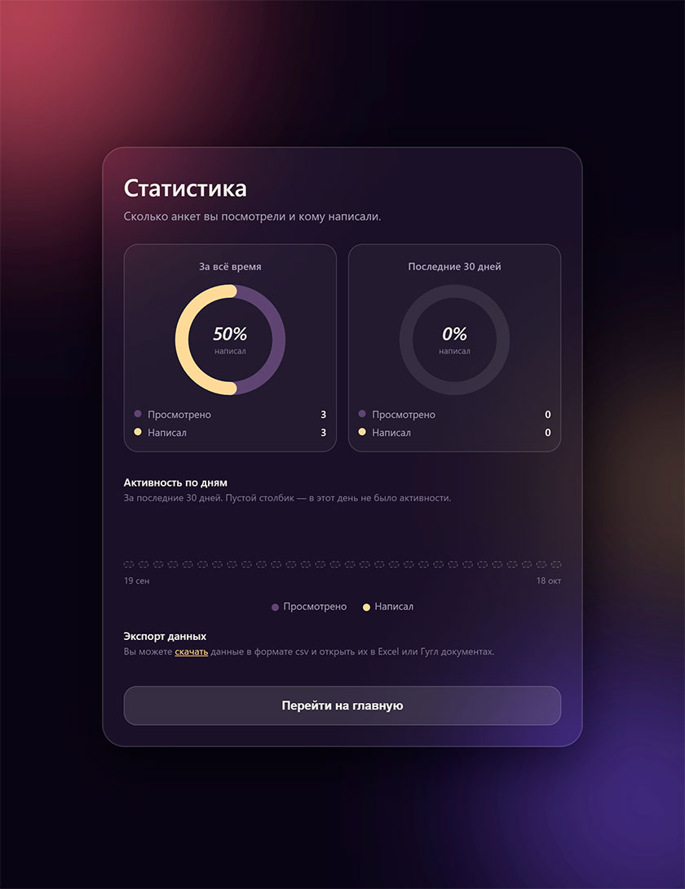

### ВК поиск

Ваш личный сайт знакомств - без ограничений и бесплатно.  
Работает на базе ВКонтакте прямо у вас на компьютере.  

### Установка
1. [Скачать](https://github.com/qvp/vk_search/releases) последнюю версию `vk_search.exe`
2. Запустить

При первом запуске создается файл `database.sqlite`. Этот файл хранит историю просмотров, его не нужно удалять.

### Ручная установка (для опытных)
1. Установить Python https://python.org/downloads
2. Установить UV https://docs.astral.sh/uv/getting-started/installation
3. Запустить `uv run uvicorn app.main:app --reload`
4. Открыть в браузере http://localhost:8000

### Сборка exe
`uv run pyinstaller --clean --noconfirm vk_search.spec`

### Скриншоты

